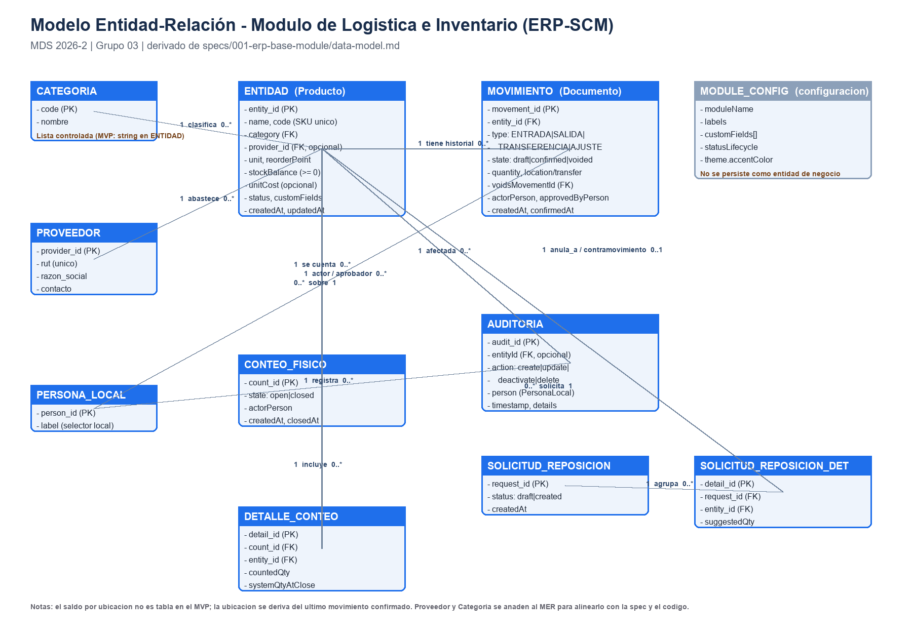

# ERP - Módulo de Logística e Inventario (SCM)

Este repositorio contiene la implementación del **Módulo de Logística e Inventario (Supply Chain Management - SCM)** para el curso **Modelación de Sistemas (2026-2)** del Departamento de Ingeniería Industrial de la Universidad de Concepción.

El desarrollo se realiza utilizando la metodología **Spec Driven Development (SDD)** sobre una plantilla base desarrollada con **Vite**, **HTML**, **CSS** y **JavaScript (Vanilla JS)**.

---

## 1. Descripción del Proyecto y MVP

El módulo permite gestionar el ciclo operativo de bodegas, control de existencias y movimiento de mercancías. Ofrece una interfaz de usuario completamente en español para la gestión de catálogo de productos, registro de proveedores y trazabilidad de entradas/salidas de stock.

### Características Principales

- **Dashboard Principal:** Métricas en tiempo real de stock total, ítems bajo punto de reorden y accesos rápidos.
- **Gestión de Entidades (Productos y Proveedores):** Administración del maestro de productos, SKU, ubicaciones y datos de proveedores.
- **Gestión de Documentos (Movimientos de Inventario):** Registro de guías de recepción, despachos y transferencias de stock.
- **Persistencia Local:** Los datos se guardan en el almacenamiento local del navegador (`localStorage`).
- **Integridad Referencial:** Eliminación física solo sin historial; con historial se desactiva conservando documentos y trazabilidad.

---

## 2. Configuración y Personalización (`src/module-config.js`)

## 2.1 Funcionalidades implementadas (feature 001-erp-base-module)

- **US1 Catálogo maestro**: campos obligatorios (nombre, código/SKU, categoría, unidad, punto de reorden), unicidad global de SKU normalizado, eliminación solo sin historial o desactivación con historial, maestro de proveedores con validación de RUT chileno (formato y dígito verificador) y vínculo producto-proveedor.
- **US2 Recepción y transferencias**: entradas con ubicación y documento de respaldo obligatorio, proveedor asociado, transferencias entre ubicaciones con validación de stock, borradores/cancelación sin persistir efectos y solicitud de alta de productos faltantes sin crearlos.
- **US3 Salidas**: validación de stock al confirmar, sugerencia FIFO basada en la entrada confirmada más antigua, motivos (incluye Merma con observación), bloqueo ante insuficiencia y señales de punto de reorden.
- **US4 Trazabilidad y control**: kardex filtrable con saldo inicial del período, inmutabilidad de movimientos confirmados/anulados con corrección por contramovimiento, conteos físicos ciegos, ajustes aprobados y vista de auditoría con filtros y valores antes/después.
- **US5 Panel y reposición**: KPIs (activos, valoración, alertas, sin movimiento 90 días, cobertura), filtros por categoría y período que recalculan tarjetas y tablas, alertas con cantidad sugerida editable y generación de solicitudes de reposición agrupadas por proveedor.
- **Búsqueda y UX**: búsqueda por nombre/código/categoría/descripción/fecha/campos personalizados, estados vacíos, renderizado seguro (sin innerHTML con datos de usuario), etiquetas y mensajes de validación accesibles.

> No existen roles operativos ni selector de rol: la identidad se elige en un selector local de persona, sin contraseña, y solo identifica al responsable en auditoría, movimientos y aprobaciones (FR-047, FR-049). Costos y valorización se muestran solo en panel y catálogo (FR-044).

> Nota: la configuración declarativa en src/module-config.js permite adaptar etiquetas, campos personalizados, ciclo de vida y tema. Las capacidades nativas de inventario descritas arriba forman parte del módulo base implementado.

La adaptación del módulo base a **Logística e Inventario** se define a través del objeto `userConfig` en el archivo `src/module-config.js`:

- **Nombre del Módulo (`moduleName`):** "Logística e Inventario"
- **Etiquetas Custom (`labels`):**
  - Entidades: **Producto / Proveedor**
  - Documentos: **Movimiento de Inventario**
- **Campos Personalizados (`customFields`):**
  - `sku` (Texto, Requerido)
  - `punto_reorden` (Número, Requerido, mínimo 0)
  - `unidad_medida` (Selección: Unidades, Cajas, Kg, Litros)
  - `tipo_movimiento` (Selección: Entrada, Salida) en documentos
- **Ciclo de Vida de Estado (`statusLifecycle`):**
  - Estados: `Borrador` → `Pendiente` → `Completado` / `Cancelado`
- **Color de Acento (`theme.accentColor`):** `#1f6feb`

---

## 3. Instalación y Ejecución

### Requisitos Previos

- Node.js (versión 18 o superior)
- npm o yarn

### Pasos para Ejecutar Localmente

1. **Clonar el repositorio:**

   ```bash
   git clone <URL_DEL_REPOSITORIO>
   cd <NOMBRE_DEL_REPOSITORIO>
   ```

2. **Instalar dependencias:**

   ```bash
   npm install
   ```

3. **Iniciar el servidor de desarrollo:**

   ```bash
   npm run dev
   ```

4. Abrir la URL indicada en la consola (por defecto: `http://localhost:5173`).

---

## 4. Pruebas Automatizadas

El proyecto cuenta con una suite de pruebas unitarias e integración con Vitest.

- **Ejecutar pruebas en modo watch:**

  ```bash
  npm test
  ```

- **Ejecutar pruebas una sola vez:**

  ```bash
  npm run test:run
  ```

- **Verificar estilo y compilar:**
  ```bash
  npm run lint
  npm run build
  ```

---

## 5. Estructura de Documentación SpecKit

La especificación detallada del módulo, requerida para las entregas del curso, se encuentra distribuida en la carpeta de especificaciones:

- [`plan.md`](./specs/001-erp-base-module/plan.md): Plan de trabajo, historias de usuario, perfiles de clientes, mitigación de sesgos y análisis de escalabilidad.
- [`data-model.md`](./specs/001-erp-base-module/data-model.md): Modelo Entidad-Relación (MER) en Mermaid, imagen del MER, diccionario de variables críticas y reglas de validación.
- [`quickstart.md`](./specs/001-erp-base-module/quickstart.md): Escenarios de validación de extremo a extremo.

---

## 6. Equipo de Trabajo e Información Académica

- **Universidad:** Universidad de Concepción
- **Facultad:** Facultad de Ingeniería
- **Departamento:** Departamento de Ingeniería Industrial (DII)
- **Asignatura:** Modelación de Sistemas (2026-2)

---

## 7. Modelo entidad-relación (imagen)



Archivo: [`docs/mer-logistica-inventario.png`](./docs/mer-logistica-inventario.png), generado a partir de [`data-model.md`](./specs/001-erp-base-module/data-model.md). Incluye `CATEGORIA`, `PROVEEDOR`, `ENTIDAD`, `MOVIMIENTO`, `PERSONA_LOCAL`, `AUDITORIA`, `CONTEO_FISICO`, `DETALLE_CONTEO`, `SOLICITUD_REPOSICION` y su detalle, además de `MODULE_CONFIG` como configuración no persistida.

## 8. Fuentes y referencias

- Universidad de Concepción, Departamento de Ingeniería Industrial. **Modelación de Sistemas 2026-2: Trabajo Grupal** (instructivo y rúbrica), 2026. Documento entregado por la cátedra.
- GitHub. **Spec Kit — Spec-Driven Development**: https://github.com/github/spec-kit
- Vite. **Documentación oficial**: https://vite.dev/
- Vitest. **Documentación oficial**: https://vitest.dev/
- MDN Web Docs. **Window.localStorage**: https://developer.mozilla.org/en-US/docs/Web/API/Window/localStorage
- OWASP. **Cross Site Scripting (XSS) Prevention Cheat Sheet**: https://cheatsheetseries.owasp.org/cheatsheets/Cross_Site_Scripting_Prevention_Cheat_Sheet.html
- W3C. **WCAG 2.2 Quick Reference**: https://www.w3.org/WAI/WCAG22/quickref/
-
