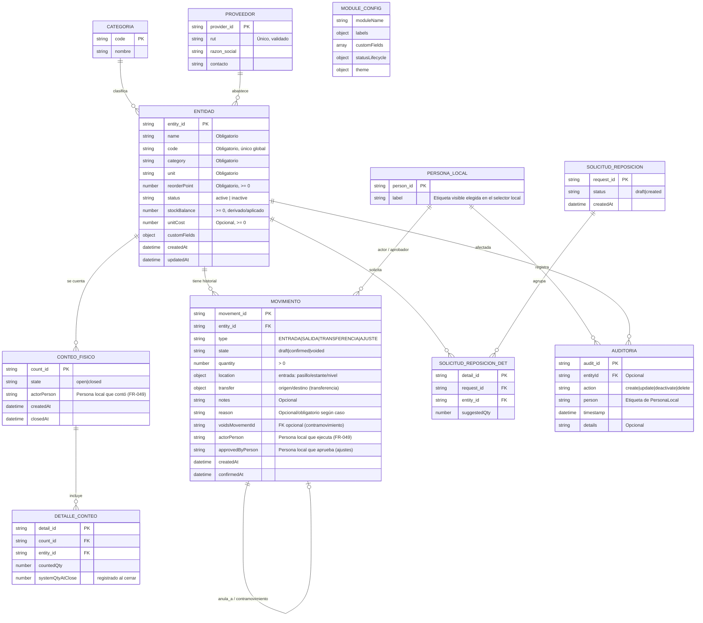

# Modelo de Datos (Phase 1): Módulo Base ERP — Logística e Inventario

**Entrada**: [spec.md](./spec.md) | **Plan**: [plan.md](./plan.md) | **Fecha**: 2026-11-17

Modelo alineado con las clarificaciones vigentes: catálogo, movimientos, kardex, conteos, indicadores y terminología configurable en alcance (la integración con Compras/Ventas, HU10, queda diferida), Transferencia como tercer tipo de documento, sin roles operativos ni visibilidad por rol, selector local de persona para auditoría y aprobaciones, campos obligatorios de entidad, unicidad de SKU, eliminación/desactivación por historial e inmutabilidad de movimientos confirmados con contramovimiento.

## 1. Diagrama Entidad-Relación (conceptual)

`MODULE_CONFIG` no se persiste como entidad de negocio; se carga al arrancar y configura etiquetas, campos, ciclo de vida y tema.

**Notas de alineación con la implementación del MVP:**

- `CATEGORIA` se modela como entidad conceptual para hacer explícita la integridad referencial con `ENTIDAD`, pero en esta versión se persiste como texto en `ENTIDAD.category`; su normalización a tabla está prevista en el plan de escalabilidad.
- `PROVEEDOR` sí está implementado como maestro con `rut` validado (formato y dígito verificador chileno) y vínculo `ENTIDAD.providerId`.
- No existe una entidad `StockUbicacion`: `ENTIDAD.stockBalance` es el saldo total y la ubicación se deriva del último `MOVIMIENTO` confirmado (FR-041). El desglose por ubicación se documenta como evolución futura en `plan.md`.
- La imagen del diagrama está disponible en [`docs/mer-logistica-inventario.png`](../../docs/mer-logistica-inventario.png).

## 2. Entidades y registros (diccionario de variables críticas)

| Variable crítica | Entidad | Regla / efecto |
|---|---|---|
| `code` (SKU) | ENTIDAD | Normalizado y único global; bloquea alta/edición duplicada |
| `reorderPoint` | ENTIDAD | ≥ 0; define alerta de reposición |
| `unitCost` | ENTIDAD | Opcional; alimenta la valoración `Σ(stock × unitCost)` solo en panel/catálogo |
| `stockBalance` | ENTIDAD | ≥ 0; se modifica solo por movimientos confirmados |
| `quantity` | MOVIMIENTO | > 0; incrementa o decrementa el saldo según `type` |
| `type` | MOVIMIENTO | `ENTRADA`, `SALIDA`, `TRANSFERENCIA` o `AJUSTE` |
| `state` | MOVIMIENTO | `draft`, `confirmed` o `voided`; los confirmados son inmutables |
| `voidsMovementId` | MOVIMIENTO | Vincula un contramovimiento al documento anulado |
| `actorPerson` / `approvedByPerson` | MOVIMIENTO | Identidad local; el aprobador debe diferir de quien contó |
| `rut` | PROVEEDOR | Único y validado con dígito verificador chileno |

### 2.1 ENTIDAD (Producto / maestro)

| Campo | Tipo | Obligatorio | Regla |
|-------|------|-------------|-------|
| `entity_id` | string | Sí (auto) | Único |
| `name` | string | Sí | No vacío |
| `code` | string | Sí | No vacío; único global tras normalización (SKU) |
| `category` | string | Sí | No vacío |
| `unit` | string | Sí | Unidad de medida (p. ej. Paquete, Unidades, Cajas, Kg, Litros) |
| `reorderPoint` | number | Sí | ≥ 0 |
| `status` | string | Sí | `active` o `inactive` (desactivada); nuevas entidades inician `active` |
| `description` | string | No | Texto libre |
| `targetDate` | string (YYYY-MM-DD) | No | Fecha válida si existe |
| `unitCost` | number | No | ≥ 0; usado solo para valoración en panel/catálogo |
| `stockBalance` | number | Sí | ≥ 0; inicia en 0; solo cambia por movimientos confirmados |
| `customFields` | object | No | Validado según `ModuleConfig` |
| `createdAt` / `updatedAt` | ISO string | Sí (auto) | Marcas de tiempo |

**Reglas**: no se permite crear/editar con `code` duplicado (excluyendo la propia entidad en edición). Si la entidad tiene movimientos/historial asociado, no se elimina físicamente: solo se desactiva (`inactive`) conservando historial. Si no tiene historial, puede eliminarse físicamente.

### 2.2 MOVIMIENTO / Documento de inventario

Registro transaccional vinculado a una entidad que afecta o traza stock.

| Campo | Tipo | Obligatorio | Regla |
|-------|------|-------------|-------|
| `movement_id` | string | Sí (auto) | Único |
| `entity_id` | string | Sí | Referencia entidad existente |
| `type` | string | Sí | `ENTRADA`, `SALIDA`, `TRANSFERENCIA`, `AJUSTE` |
| `state` | string | Sí | `draft`, `confirmed`, `voided` (o contramovimiento generado) |
| `quantity` | number | Sí | > 0 |
| `location` | object | Según tipo | Entrada: `{ aisle, shelf, level }` obligatorio |
| `transfer` | object | Transferencia | `{ from: {aisle,shelf,level}, to: {aisle,shelf,level} }` |
| `reason` | string | Según caso | Motivo; obligatorio en ajustes y cuando aplique (p. ej. merma en salida si se modela así) |
| `notes` | string | No | Texto libre |
| `voidsMovementId` | string | No | Referencia al movimiento anulado (contramovimiento) |
| `actorPerson` | string | Sí al confirmar | Etiqueta de la persona local del selector (FR-049); no es un rol |
| `approvedByPerson` | string | Solo ajustes | Persona local que aprueba; debe diferir de quien contó (HU4#4) |
| `createdAt` | ISO string | Sí (auto) | Marca de tiempo del registro |
| `confirmedAt` | ISO string | Condicional | Al confirmar |

**Inmutabilidad**: movimientos `confirmed` no se editan ni eliminan; las correcciones se realizan mediante anulación que genera un contramovimiento vinculado. Solo `draft`/no confirmados pueden editarse o cancelarse. No existe rango de fechas inicial/final como campo del registro.

### 2.3 CONTEO FISICO y DETALLE_CONTEO

Soporte nativo para conteo ciego y ajustes derivados.
- `CONTEO_FISICO`: estado (`open`/`closed`), actor de conteo (etiqueta local), fechas. La cantidad del sistema no se muestra durante la captura (conteo ciego) y la diferencia se calcula/expone al cerrar.
- `DETALLE_CONTEO`: por entidad, cantidad contada y cantidad de sistema registrada al cierre para traza.
- Diferencias generan ajustes (movimiento `AJUSTE`) con motivo obligatorio; la aprobación se registra con etiqueta de actor distinta a la del conteo.

### 2.4 SOLICITUD_REPOSICION y detalle

Soporte nativo para reposición (HU5): solicitud con líneas por entidad/producto, cantidad sugerida editable (`stock_maximo − stock_actual` cuando aplique) y agrupación por proveedor como vista/lógica de negocio. Vinculada a entidades y estado de stock.

### 2.5 MODULE_CONFIG

Contrato en [contracts/module-config.md](./contracts/module-config.md): `moduleName`, `labels`, `customFields`, `statusLifecycle`, `theme.accentColor`.

### 2.6 PERSONA_LOCAL y AUDITORIA

- **PERSONA_LOCAL**: etiqueta elegida en un selector local sin contraseña ni permisos (FR-049). No es un rol y no habilita ni oculta funcionalidad.
- **AUDITORIA**: registro automático de cada creación, edición o desactivación de entidad (HU1#4) con `action`, `person` (PersonaLocal), `timestamp` y, si aplica, `entityId` y `details`. Las aprobaciones de ajustes guardan además `approvedByPerson` en el movimiento.

La separación de funciones se valida comparando la persona del conteo con `approvedByPerson`; ambas deben ser distintas.

## 3. Relaciones e Integridad

- `ENTIDAD 1 — 0..* MOVIMIENTO` (y otros registros asociados como conteos/solicitudes).
- Integridad referencial: movimientos/conteos/solicitudes referencian entidades existentes.
- **Eliminación**: si existen registros asociados, la entidad no se elimina físicamente; se desactiva. Si no existen, se permite eliminación física (FR-003/FR-009).
- Ubicación actual del producto: derivada del movimiento de entrada o transferencia confirmado más reciente (no duplicada en entidad; FR-041).
- Campos personalizados se persisten junto a campos base sin cambiar la estructura.
- Toda operación de entidad genera auditoría con la persona local activa (FR-049).

## 4. Reglas de Validación

### Entidad
1. `name`, `code`, `category`, `unit` no vacíos.
2. `reorderPoint` obligatorio y ≥ 0.
3. `code` único global (normalizado), excluyendo la propia entidad en edición.
4. `unitCost` y `reorderPoint` numéricos ≥ 0 cuando aplican.
5. `targetDate` válida si existe.
6. Campos personalizados obligatorios/tipados según configuración.
7. `stockBalance` nunca negativo.

### Movimiento
1. `entity_id` existente y entidad elegible para operar.
2. `type` válido (`ENTRADA|SALIDA|TRANSFERENCIA|AJUSTE`).
3. `quantity` > 0.
4. `ENTRADA`: ubicación completa (`aisle`,`shelf`,`level`).
5. `TRANSFERENCIA`: origen y destino válidos; cantidad ≤ stock disponible en origen.
6. `SALIDA`: cantidad ≤ stock disponible (validación al confirmar, no solo al abrir formulario).
7. `AJUSTE`: motivo obligatorio; `approvedByPerson` obligatorio y distinto de la persona que hizo el conteo (HU4#4, FR-049).
8. Confirmados: inmutables; corrección solo por anulación/contramovimiento.
9. Estado/ciclo de vida: si hay `statusLifecycle` configurado, transiciones válidas; si no, texto libre donde corresponda.

### Conteo y reposición
1. Conteo ciego: no exponer cantidad de sistema durante captura.
2. Ajuste derivado requiere motivo y aprobación con persona local distinta a la del conteo.
3. Solicitud de reposición agrupa líneas y sugiere cantidad editable según regla definida.
4. Toda creación/edición/desactivación de entidad queda en auditoría con persona local y fecha.

### Configuración
1. Inválida/conflictiva se informa claramente (sin fallo silencioso).
2. Sin configuración: valores base Entidad/Documento, sin campos personalizados ni ciclo de vida.
3. Choques de claves o tipos inválidos se informan.

## 5. Efectos de stock y trazabilidad

| Tipo | Efecto (al confirmar) |
|------|------------------------|
| `ENTRADA` | Incrementa stock total y de la ubicación de entrada |
| `SALIDA` | Disminuye stock (bloqueada si excede disponible) |
| `TRANSFERENCIA` | Disminuye origen y aumenta destino; total sin cambio |
| `AJUSTE` | Corrige saldo según diferencia aprobada; queda trazado en kardex |

- El saldo se actualiza de forma atómica al confirmar; cancelar/abortar no altera stock.
- Kardex: lista movimientos en orden cronológico con tipo, documento, cantidad, saldo, ubicación y persona local responsable, filtrable por fecha y tipo.
- Anulación: genera contramovimiento enlazado al original; el saldo debe poder reconstruirse desde el historial.

## 6. Indicadores del Panel (HU5)

- N° de productos activos, valoración total `Σ(stockBalance × unitCost)` (solo panel/catálogo), N° en alerta (stock ≤ punto de reorden), productos sin movimiento en 90 días.
- Alertas: rojo si stock 0, amarillo si bajo punto de reorden; cantidad sugerida `stock_maximo − stock_actual` editable cuando aplique.
- Filtros (p. ej. categoría) recalculan KPIs y tabla; rotación con < 30 días de historial se muestra como "Datos insuficientes".
