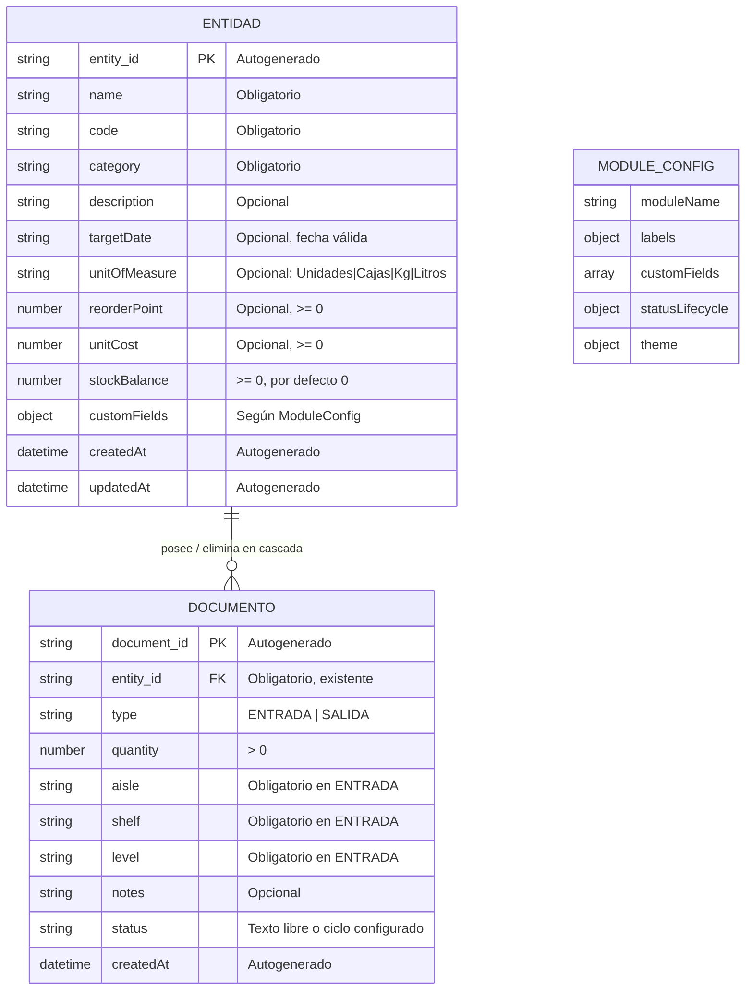

# Modelo de Datos (Phase 1): Módulo Base ERP — Logística e Inventario

**Entrada**: [spec.md](./spec.md) | **Plan**: [plan.md](./plan.md) | **Fecha**: 2026-11-10

Este modelo refleja las clarificaciones del 2026-11-10: categoría obligatoria, `costo_unitario` opcional, ubicación por movimiento de entrada y documentos sin rango de fechas.

## 1. Diagrama Entidad-Relación

`MODULE_CONFIG` no es una entidad persistida: se carga al arrancar y configura etiquetas, campos, ciclo de vida y tema.

## 2. Entidades

### 2.1 ENTIDAD (Producto / Proveedor)

Registro de datos maestros. Los módulos personalizados definen su significado real mediante configuración.

| Campo | Tipo | Obligatorio | Regla |
|-------|------|-------------|-------|
| `entity_id` | string | Sí (autogenerado) | Único; vincula documentos |
| `name` | string | Sí | No vacío; se muestra en listas y búsqueda |
| `code` | string | Sí | No vacío; identifica el registro (p. ej., SKU) |
| `category` | string | Sí | No vacío; habilita filtro y agrupación |
| `description` | string | No | Texto libre |
| `targetDate` | string (YYYY-MM-DD) | No | Fecha de calendario válida cuando existe |
| `unitOfMeasure` | string | No | `Unidades`, `Cajas`, `Kg` o `Litros` |
| `reorderPoint` | number | No | ≥ 0; umbral de nivel crítico |
| `unitCost` | number | No | ≥ 0; base de la valoración de stock |
| `stockBalance` | number | Sí | ≥ 0; inicia en 0 |
| `customFields` | object | No | Claves/valores validados según `ModuleConfig` |
| `createdAt` | string ISO | Sí (autogenerado) | Marca de tiempo de creación |
| `updatedAt` | string ISO | Sí (autogenerado) | Se actualiza en cada edición |

**Campos personalizados del módulo de logística** (declarados en `userConfig.customFields`):

| Clave | Tipo | Obligatorio | Opciones |
|-------|------|-------------|----------|
| `sku` | text | Sí | — |
| `punto_reorden` | number | Sí | — |
| `unidad_medida` | select | No | Unidades, Cajas, Kg, Litros |

`costo_unitario` es un campo base opcional, no un campo personalizado, porque alimenta el KPI de valoración.

### 2.2 DOCUMENTO (Movimiento de Inventario)

Registro transaccional asociado exactamente a una entidad.

| Campo | Tipo | Obligatorio | Regla |
|-------|------|-------------|-------|
| `document_id` | string | Sí (autogenerado) | Único |
| `entity_id` | string | Sí | Debe coincidir con una entidad existente |
| `type` | string | Sí | `ENTRADA` o `SALIDA` |
| `quantity` | number | Sí | Entero > 0 |
| `aisle` | string | Solo `ENTRADA` | Pasillo; no vacío |
| `shelf` | string | Solo `ENTRADA` | Estante; no vacío |
| `level` | string | Solo `ENTRADA` | Nivel; no vacío |
| `notes` | string | No | Texto libre |
| `status` | string | No | Texto libre, o estado válido del ciclo configurado |
| `createdAt` | string ISO | Sí (autogenerado) | Marca de tiempo del movimiento |

No existen `startDate`, `endDate` ni rango de fechas en documentos.

### 2.3 MODULE_CONFIG

Objeto de configuración cargado al arrancar. Contrato completo en [contracts/module-config.md](./contracts/module-config.md).

| Campo | Tipo | Efecto |
|-------|------|--------|
| `moduleName` | string | Nombre en barra superior y logotipo derivado |
| `labels` | object | Reetiqueta entidad, documento, botones, pestañas y mensajes |
| `customFields` | array | Campos dinámicos en formularios, listas, validación y búsqueda |
| `statusLifecycle` | object | Estados y transiciones permitidas de documentos |
| `theme.accentColor` | string | Color de acento válido; si falta o es inválido, se usa el valor base |

## 3. Relaciones e Integridad

- `ENTIDAD 1 — 0..* DOCUMENTO`: cada documento referencia exactamente una entidad por `entity_id`.
- Al eliminar una entidad se eliminan en cascada todos sus documentos (FR-009, XR-004).
- El saldo de stock pertenece a la entidad y se modifica solo mediante documentos de movimiento.
- La ubicación física pertenece al documento de entrada; el detalle del producto deriva la ubicación del documento de entrada más reciente.
- Los valores de campos personalizados se persisten junto a los campos base sin cambiar la estructura.

## 4. Reglas de Validación

### Entidad

1. `name` no vacío (FR-001, FR-006).
2. `code` no vacío (FR-001).
3. `category` no vacío (clarificación 2026-11-10).
4. `targetDate`, si existe, debe ser una fecha de calendario válida.
5. Campos personalizados obligatorios deben tener valor; el tipo debe coincidir con el declarado (FR-027).
6. `reorderPoint` y `unitCost`, si existen, deben ser números ≥ 0.
7. `stockBalance` nunca puede ser negativo.

### Documento

1. `entity_id` debe existir (integridad referencial).
2. `type` debe ser `ENTRADA` o `SALIDA` (FR-043).
3. `quantity` debe ser entero > 0.
4. Un documento `ENTRADA` exige `aisle`, `shelf` y `level` no vacíos (FR-041).
5. Una `SALIDA` cuya `quantity` supere `stockBalance` se rechaza con mensaje descriptivo (FR-042).
6. `status`, si el ciclo de vida está configurado, debe ser un estado válido y respetar las transiciones permitidas (FR-030).

### Configuración

1. Configuración inválida o conflictiva se informa claramente, sin fallar en silencio (FR-025).
2. Sin configuración se usan los valores base Entidad/Documento, sin campos personalizados ni ciclo de vida (FR-024).
3. Un campo personalizado cuya clave choque con un campo base debe rechazarse o informarse.
4. Un tipo de campo desconocido o una transición inválida debe informarse.

## 5. Transiciones de Estado y Efectos sobre Stock

### Efectos de stock

| Tipo de documento | Efecto | Condición |
|-------------------|--------|-----------|
| `ENTRADA` | `stockBalance = stockBalance + quantity` | Siempre válida |
| `SALIDA` | `stockBalance = stockBalance - quantity` | Solo si `quantity ≤ stockBalance` |

El saldo se actualiza de forma atómica al guardar el documento. Cancelar o volver sin guardar no altera el saldo (FR-040, escenarios US3/US4).

### Ciclo de vida de documentos

- Sin `statusLifecycle` configurado: `status` es texto libre (FR-031).
- Con `statusLifecycle` configurado: solo se ofrecen estados y transiciones declarados; las transiciones inválidas se rechazan con explicación (FR-030).
- El efecto sobre stock se aplica al confirmar el documento según la regla de negocio del módulo; el estado no cambia el signo del movimiento.

## 6. Indicadores del Panel

| KPI | Cálculo | Fuente |
|-----|---------|--------|
| Total de registros | Número de entidades almacenadas | ENTIDAD |
| Valoración total del stock | `Σ(stockBalance × unitCost)` | ENTIDAD |
| Productos en nivel crítico | Entidades con `stockBalance < reorderPoint` | ENTIDAD |
| Movimientos recientes | Documentos ordenados por `createdAt` descendente | DOCUMENTO |

Los KPIs se recalculan al mostrar el panel y al aplicar un filtro de categoría (US5). La valoración se muestra solo en panel/catálogo, nunca como entrada en formularios de movimiento.
